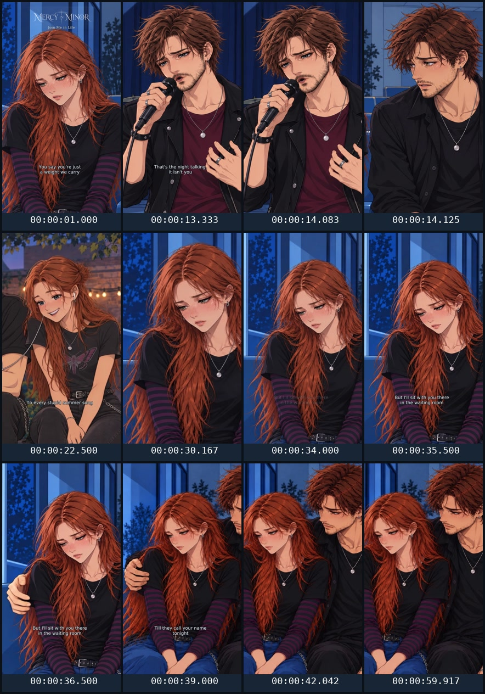

# Mercy in Minor Studio

Dario's working studio for Mercy in Minor music videos: song/story direction, character art, Blender edits, audio, renders, and the records needed to continue across sessions.

**Current production: [Join Me in Life](productions/join-me-in-life/README.md).** Active work is the **[movie-and-band recreation](productions/join-me-in-life/full-film/performance-cut/README.md)**. The preserved completed **[C — Unfinished Morning](productions/join-me-in-life/full-film/unfinished-morning/DELIVERY.md)** uses the entire original song and reviewed motion throughout. The roughly one-minute Revision 4 Short and first hybrid film remain historical baselines. [Current state and next action](productions/join-me-in-life/STATUS.md) · [Decisions](productions/join-me-in-life/DECISIONS.md) · [Latest session handoff](productions/join-me-in-life/SESSIONS.md).

Play the [captioned portrait baseline](productions/join-me-in-life/current/exports/Join_Me_in_Life_Short_Hybrid_Camera.mp4), or open its [portrait scene](productions/join-me-in-life/current/Join_Me_in_Life_experimental_vert.blend) with the matching runtime. Keep the scene beside `assets/`. In this archive, **experimental = current hybrid**, **simple = Revision 3 comparison**, and **pilot = separate eight-second technical study**. These labels do not establish final creative approval.



## Start or resume

Open this repository in Codex, then run from its root:

```sh
python3 tools/studio.py
```

This read-only command shows the active production, its current state, branch/commit, and local changes. Agents must read [AGENTS.md](AGENTS.md) and [PROJECT_MEMORY.md](PROJECT_MEMORY.md). Use `python3 tools/studio.py --refresh` to discover relevant remote branch work without changing this checkout. The [session guide](docs/SESSION_GUIDE.md) defines what to read at startup and what to record before leaving; [studio.json](studio.json) selects the default production without renaming its files.

For a fresh Codex cloud task, select **cromicron/music-video-studio** as the repository. A restored checkout may predate current main: use the [verified sync procedure](AGENTS.md#sync-a-saved-codex-checkout). Preserve any task branch or uncommitted work. Changes on a local branch reach fresh main-based sessions only after being shared and merged.

## Find the right place

| Need | Go to |
| --- | --- |
| Recover accumulated knowledge and missing-history boundaries | [Project memory](PROJECT_MEMORY.md) · [history coverage](docs/HISTORY_INDEX.md) · [researched Cloud continuity](docs/CLOUD_CONTINUITY.md) |
| Understand the whole repository or add another song | [Structure and production method](docs/STRUCTURE.md) · [new-production templates](templates/production/) |
| Understand today's work, pending review and next action | [Join Me in Life status](productions/join-me-in-life/STATUS.md) |
| Recover creative choices and their evidence | [Decision record](productions/join-me-in-life/DECISIONS.md) |
| Find the camera, animation, captions or other edit inputs | [Current edit source map](productions/join-me-in-life/current/SOURCES.md) |
| Set up Blender, render or check a candidate | [Native render guide](productions/join-me-in-life/BLENDER.md) · [tool guide](tools/README.md) |
| Browse approved references and art candidates | [Art guide and index](productions/join-me-in-life/art/README.md) |
| Develop the full-length film | [Recording, final lyrics and Short alignment](productions/join-me-in-life/full-song/README.md) |
| Recover optional exports or historical work | [Media recovery](MEDIA.md) · [historical notes guide](productions/join-me-in-life/notes/README.md) |
| Find shared band identity and source links | [Band guide](band/README.md) |
| Use automated review and production rendering | [GitHub workflow guide](.github/README.md) |

## Check and preview

Python 3.11+ is enough for the source and layout checks:

```sh
python3 tools/studio.py --check
python3 tools/review.py --source-only
```

For native scene work, verify the prepared Python/bpy runtime with `python3 tools/studio.py --runtime`; see [BLENDER.md](productions/join-me-in-life/BLENDER.md) for setup and alternatives. Do not assume the system `blender` has the production version.

With FFmpeg/ffprobe and the required fonts, `python3 tools/review.py --full-decode` verifies the original baseline and writes `build/join-me-in-life/revision4-contact-sheet.jpg`. A candidate encode needs the separate checks in the native guide; matching the baseline is not expected after an edit.

For branch previews, use [Actions → Render a studio edit](https://github.com/cromicron/music-video-studio/actions/workflows/render-edit.yml). It renders a selected range or the full Short in portrait-captioned, portrait-clean or widescreen format. Select the branch containing the work. [Baseline review](https://github.com/cromicron/music-video-studio/actions/workflows/review-short.yml) provides a contact sheet and waiting-room playback clip of the original cut.

You can simply ask: **“Show me a captioned portrait preview of the waiting-room embrace from 34 to 39 seconds, with the original audio.”**

## Keep the studio understandable

After meaningful work, update the production's STATUS and session log; record confirmed direction and evidence in DECISIONS. Keep imported history intact and label candidates honestly. Follow the [session handoff method](docs/SESSION_GUIDE.md#before-finishing) so the next session has an exact continuation point.

Track source, provenance, accepted baseline references, and these records in Git. Keep frame caches, scratch, routine exports, downloads and environments ignored. Optional baseline media lives in the [Revision 4 release](https://github.com/cromicron/music-video-studio/releases/tag/join-me-in-life-r4); the original scripts retain their portable paths. The [repository map](docs/STRUCTURE.md) explains why these paths and baseline records stay stable.
